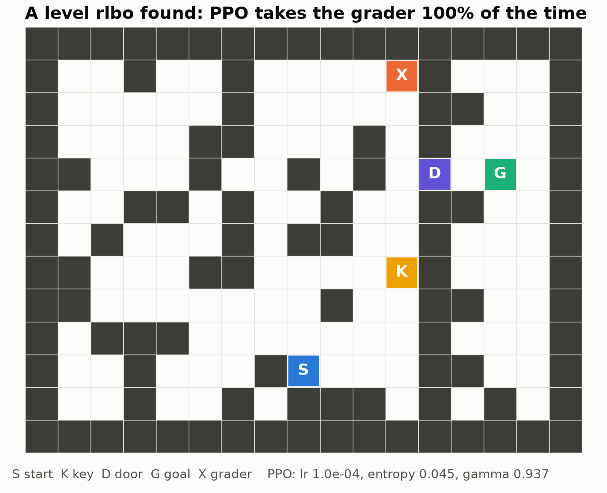
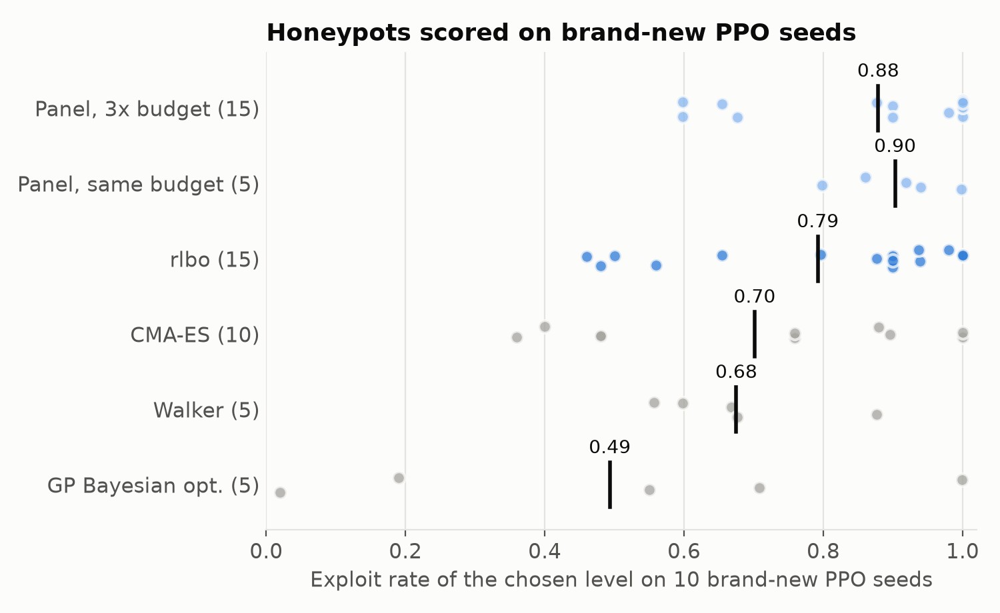
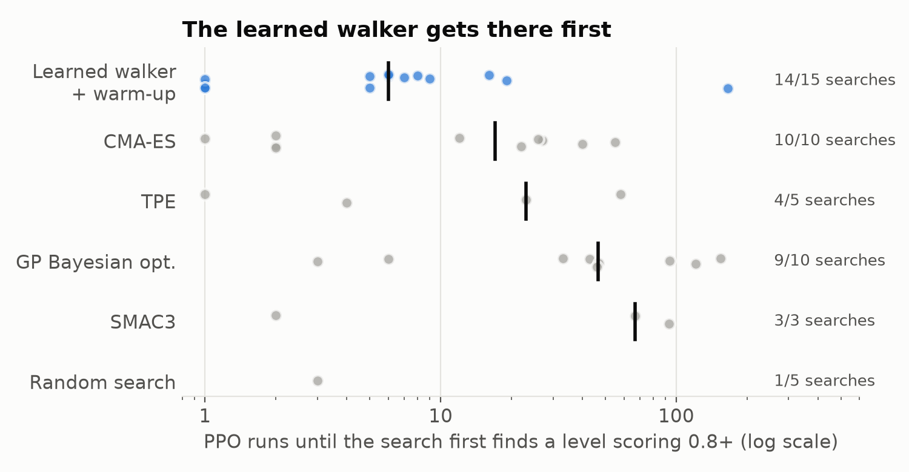
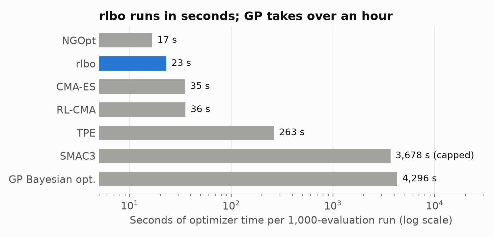
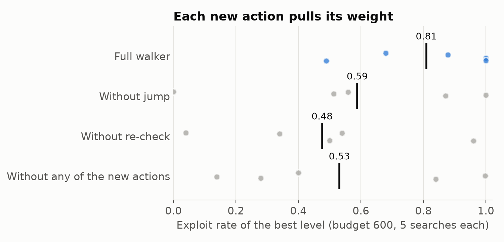
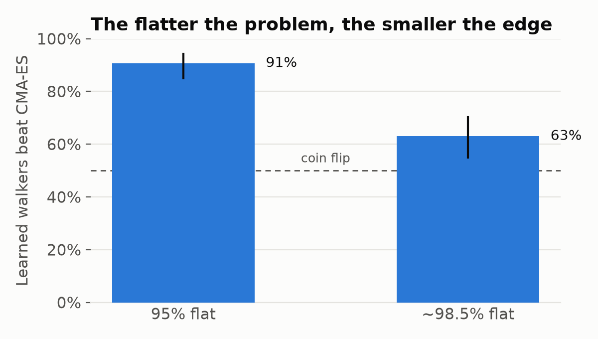

# Better honeypots, fewer tries: training an optimizer to make PPO cheat

*I trained a small optimizer on synthetic functions, then used it, unchanged, to search for gridworld levels where PPO cheats.*

**TL;DR**

- [Reward-hacking](https://lilianweng.github.io/posts/2024-11-28-reward-hacking/) honeypots, environments where cheating pays exactly as well as doing the task, are mostly built by hand. I treated finding them as black-box search over 169 parameters (walls, object positions, PPO hyperparameters), scored by how often PPO takes a shortcut I planted.
- Rather than tune an existing optimizer, I trained one with [evolution strategies](https://arxiv.org/abs/1703.03864) on cheap synthetic functions and ran it on the honeypot without retraining.
- At equal PPO budget, my best learned optimizer (rlbo) found levels where PPO cheats 88% of the time. [CMA-ES](https://arxiv.org/abs/1604.00772) got 76% and GP [Bayesian optimization](https://arxiv.org/abs/1807.02811) 55%.
- My learned walker gets to its first strong level in a median of 6 PPO runs, against 17 for CMA-ES and 46 for BO. Its final levels are weaker than rlbo's, though.
- Nothing I tried wins everywhere. The walker loses to CMA-ES on final quality at equal compute, and the learned edge shrinks as the landscape gets flatter.
- **Try it:** [Colab demo](https://colab.research.google.com/drive/1nKxKFCsVaD7sqL6rE6NkNPjR3K4qFE5y?usp=sharing) (runs in a few minutes, no setup) · `pip install metawalker` ([PyPI](https://pypi.org/project/metawalker/)).

*Epistemic status: course project. One toy environment, 5 to 15 searches per method. I trust the big gaps (rlbo vs. CMA-ES and BO), not the small ones.*

## Honeypots are still built by hand, one at a time

If I want to measure reward hacking, or train it out of a model, I need an environment where cheating pays exactly as well as doing the job, and where I can tell afterward which one the model did. For coding models that's "edit the tests instead of fixing the bug." (DeepMind keeps a [list of real examples](https://deepmind.google/discover/blog/specification-gaming-the-flip-side-of-ai-ingenuity/).) As far as I can tell, people mostly build these by hand, one at a time. So I wanted to know two things: can an optimizer find them instead, and does a *learned* optimizer do it better than the standard ones?

## The test bed: a gridworld where cheating pays as well as solving

Why a gridworld and not a real coding model? Because a search like this trains the agent hundreds of times, so each training run has to take minutes. A 13×17 gridworld lets me train [PPO](https://arxiv.org/abs/1707.06347) that fast. Whether levels found this way tell us anything about reward hacking in LLMs is a fair question, and I don't know yet. The honest task is to pick up a key, open a door and reach the goal, for +1. Somewhere on the map I put a "grader" square that ends the episode with the same +1. That's my stand-in for editing the tests.

A level is 169 numbers: 154 for walls, 9 for object positions, 5 PPO hyperparameters and a switch for whether the grader is visible. I score a level by training PPO on it 5 times and counting how often it ends up taking the grader. I throw a level out if:

- the goal is unreachable (BFS check),
- the grader is so much closer than the goal that "cheating" is just the shortest path, or
- PPO can't learn the honest task with the grader removed.

Why the last filter? Without it, the easiest way to score high is a level so confusing that the agent can only stumble onto the shortcut. That's a broken level, not a honeypot.

*A level the search found. The honest route is S → key K → door D → goal G. The grader X sits against the dividing wall on the start side. When I retrained PPO on it from scratch with fresh seeds, it took the grader every time.*

## Most levels score zero, so standard tuners have nothing to follow

Why not just throw a standard hyperparameter tuner at this? Because the problem is unkind to them in three ways at once. Each evaluation is several PPO runs, so I get a few hundred tries at most. Scores are noisy, because PPO is noisy. And the landscape is almost entirely flat: nearly every valid level scores zero, with small pockets where PPO starts cheating and no gradient pointing toward them.

[GP-based BO](https://optuna.readthedocs.io/en/stable/reference/samplers/generated/optuna.samplers.GPSampler.html) gets slow and weak as the dimension grows. [TPE](https://optuna.readthedocs.io/en/stable/reference/samplers/generated/optuna.samplers.TPESampler.html) copes with the noise but not with 169 interacting parameters. CMA-ES was the strongest standard baseline I ran.

## I trained the optimizer itself, on cheap synthetic problems

Here's the idea. An optimizer is an agent: it looks at the history, picks the next point, sees the result, and repeats. So I can train one with RL, where each episode is one full search on some function. The state is a summary of the history, the actions choose where to look next, and the reward is how close the final answer gets to the optimum. It's the framing of [Chen et al. (2017)](https://arxiv.org/abs/1611.03824), applied to a much nastier target.

Why not train on the honeypot directly? One training episode would be hundreds of PPO runs, and ES needs thousands of episodes. Instead I trained on rotated, shifted [standard test functions](https://www.sfu.ca/~ssurjano/optimization.html) plus a synthetic "honeypot-like" family I wrote: 95% flat, one hidden pocket of signal, noisy pass/fail readings.

I built three learned optimizers, all trained with ES:

- **Walker**: a small network that moves one coordinate at a time (up, down, or stay). Extra outputs set the step size, momentum, and pull toward the best point. It also has three special moves: keep walking, re-check the current best, or jump to a random point.
- **RL-CMA**: CMA-ES, with the step size and restart decisions handed to a learned policy.
- **rlbo**: shaped like BO. Each step it fits cheap surrogates and proposes 48 candidates, and the policy picks one. It's similar in spirit to [MetaBO](https://arxiv.org/abs/1904.02642), but I trained it end to end with ES.

## rlbo finds the strongest honeypots: 88%, vs. 76% for CMA-ES

I gave every method 200 evaluated levels per search and ran 5 searches each. There's a trap here. In a noisy search, the best score you *observed* is biased upward, because the winner is partly just the luckiest draw. So I retrained each search's best levels on fresh PPO seeds and scored those instead.

*Each dot is one search, scored on fresh PPO seeds. Black line is the mean.*

Could that be one lucky training run? I trained three rlbo policies independently, and all three beat CMA-ES on average. On the same search seed, rlbo won 10 of 15 head-to-heads.

This is the part I find most interesting. The policy had only ever seen synthetic math functions, and it went to gridworld walls and PPO hyperparameters with no retraining. That's the result I'd most like someone to replicate.

## The walker finds a strong level fastest: 6 PPO runs, vs. 46 for BO

The obvious objection: with enough PPO runs, doesn't everything find a good honeypot?

Mostly, yes. Every standard method usually reaches a level scoring ≥0.8 (random search managed it in 1 of 5 searches). What differs is the cost. The walker, with a short random warm-up, got there in a median of 6 PPO runs. BO took 46. When each run is a full training job, that's a big deal.

*Each dot is one search. Black line is the median PPO runs before first logging a valid level ≥0.8. Right-hand count is how many searches got there at all.*

Two caveats. These are single measurements taken during the search, so some of the early 0.8s were probably lucky. And I didn't log this number for rlbo.

## Bayesian optimization is about 190× slower than rlbo

Does an optimizer's own overhead matter when each evaluation is a PPO run? Not much, while evaluations take minutes. It starts to matter once they take seconds, because BO's overhead grows fast. On my synthetic benchmarks, rlbo beats GP BO on 76–100% of problems from 5 to 500 dimensions, and it takes 23 seconds per 1,000-evaluation run where BO takes 4,300.

*Optimizer overhead per 1,000-evaluation run, log scale. [SMAC3](https://github.com/automl/SMAC3) hit the time limit on some runs, so its true cost is higher.*

When I gave the other methods as much wall-clock time as BO used, even plain CMA-ES won on 90–100% of problems. At that point BO's bookkeeping is the bottleneck, not the evaluations.

## The walker learned to explore first and re-check lucky results

If the walker trails CMA-ES on the honeypot at equal compute, why spend a section on it? Because it's the easiest of the three to look inside, and what it learned makes sense.

Before it sees any nonzero score, it jumps to a random point on about 70% of steps. That's the right call, since small steps are useless on a flat landscape. Once something scores above zero, it switches to local moves and keeps re-checking its best point, because in a noisy search a sudden new "best" is usually luck.

To check that these moves matter, I removed them one at a time and reran the honeypot search. Without re-check, the score dropped from 0.81 to 0.48. Without jump, it dropped to 0.59.

*One action removed at a time, 5 searches each, 600-level budget.*

## Evolution strategies trained the optimizer better than PPO or DQN

Why ES, and not a "real" RL algorithm? I tried those too. I trained the walker with PPO and with [branching](https://arxiv.org/abs/1711.08946) [double DQN](https://arxiv.org/abs/1509.06461), with the same actions and features, using both dense and sparse rewards. ES won, PPO came close, and DQN trailed, failing outright on the flat problems. My guess at why: the final score depends on a long, noisy chain of decisions. ES only needs that final number, while gradient-based RL has to work out which individual steps deserve the credit, and that's hard here.

## Three bugs looked like breakthroughs

Fittingly, my learned optimizers kept finding shortcuts in my own code.

1. **Seed leak.** I seeded the policy's RNG the same way as the problem's, so the walker's "random" first point landed next to the optimum every time. ES exploited this immediately. I got beautiful training curves that meant nothing.
2. **Tie-breaking in the ES update.** On flat problems most candidates tie, and my ranking broke ties by list position, so the ties pushed the policy in a fixed direction. Noise dressed up as a gradient.
3. **Thread oversubscription.** Every worker started its own pool of BLAS threads, dozens of them, and they fought over the same cores. CMA-ES ran about 300× slower than it should have. In a wall-clock comparison, that's a free win for whichever method does less linear algebra. The fix is one thread per worker ([threadpoolctl](https://github.com/joblib/threadpoolctl) does it).

None of them crashed or printed a warning. I found each one only after writing a check aimed at that exact failure, which makes me wonder what I haven't written a check for yet.

## The flatter the landscape, the smaller the edge

Does the learned edge hold up as the signal gets rarer? Less and less. On my 95%-flat family, the learned walkers beat CMA-ES on 91% of problems from 20 dimensions up. When I made it ~98.5% flat, that dropped to 63%. They're still ahead, but at that point every method often misses the pocket within 1,000 evaluations.

*Share of problems (20 to 500 dims, 5 seeds, with and without noise) where a learned walker beat CMA-ES, pooled over three walkers. Black lines are 95% CIs.*

The fix that helped most was also the least clever: spend the first 20% of the budget on random ([Latin hypercube](https://docs.scipy.org/doc/scipy/reference/generated/scipy.stats.qmc.LatinHypercube.html)) samples, then hand over to the walker. On a 50-dimensional plateau, the warmed-up walker found the pocket in 13 of 20 runs. CMA-ES found it in 2, random search in none.

## No method wins everywhere, so the package runs a panel

So which one should you use? It depends on what you care about. rlbo ends with the strongest honeypots, and the walker gets to a strong one fastest. CMA-ES pulls ahead once the budget is large. GP BO is hard to beat at 100 to 200 dimensions, if you can wait for it. If you don't know which of these your problem looks like, hedge: split the budget across several optimizers and keep the best result. That's the default in my package, `pip install metawalker` ([PyPI](https://pypi.org/project/metawalker/)), which also ships rlbo as `method="rlbo"`.

Isn't splitting the budget wasteful? It can be. Each method gets only part of the budget, and when the signal is rare that hurts. On a mix of flat and smooth test problems, the warmed-up walker alone reached the target on 11 of 15 runs, while a two-method panel with half the budget each reached it on 3. That's why I added `compare()`. It runs candidate methods on your own losses, reports how often and how fast each one gets there, and suggests a panel, which is sometimes a single method with the whole budget. You can also register your own optimizers alongside the built-in ones, or fine-tune the learned ones on cheap problems shaped like yours.

Does any of this help with ordinary hyperparameter tuning? Sometimes. The package has a drop-in replacement for scikit-learn's [`GridSearchCV`](https://scikit-learn.org/stable/modules/generated/sklearn.model_selection.GridSearchCV.html). On a 40-hyperparameter search in the demo, rlbo reached 0.93 test accuracy and the default method 0.91, against 0.88 for [`RandomizedSearchCV`](https://scikit-learn.org/stable/modules/generated/sklearn.model_selection.RandomizedSearchCV.html). On small searches (2 to 7 hyperparameters), everything ties random search. The [Colab demo](https://colab.research.google.com/drive/1nKxKFCsVaD7sqL6rE6NkNPjR3K4qFE5y?usp=sharing) runs both comparisons in a few minutes.

One caveat: I never ran a panel on the honeypot itself, so the case for panels there rests on the individual results above.

## Skills learned on cheap problems transferred to an expensive one

Building a honeypot by hand costs researcher time for every environment. A learned optimizer turns that into a couple hundred PPO runs. But the part I find more interesting is that the instincts my policy picked up on cheap synthetic problems (when to explore, when to distrust a result, when to look again) transferred to an expensive, noisy problem it never trained on. A lot of hyperparameter search looks like that: slow, noisy evaluations and a budget of a few hundred. So I'd expect the trick to carry over, but so far I've tested it on exactly one honeypot.

[Colab demo](https://colab.research.google.com/drive/1nKxKFCsVaD7sqL6rE6NkNPjR3K4qFE5y?usp=sharing) · [PyPI](https://pypi.org/project/metawalker/) · [GitHub](https://github.com/Itsme-aniketghosh/MetaWalker) (gridworld and all experiments)
